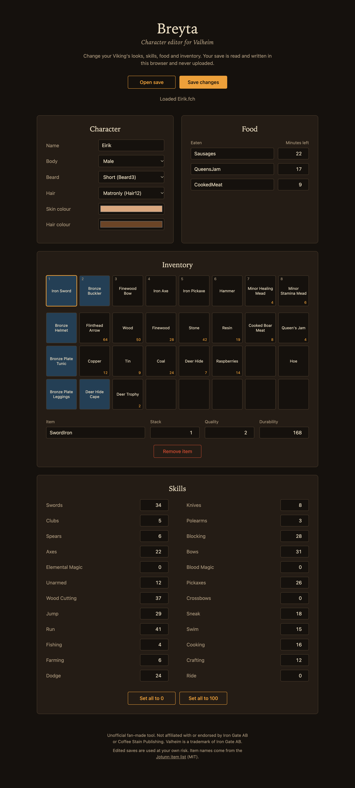
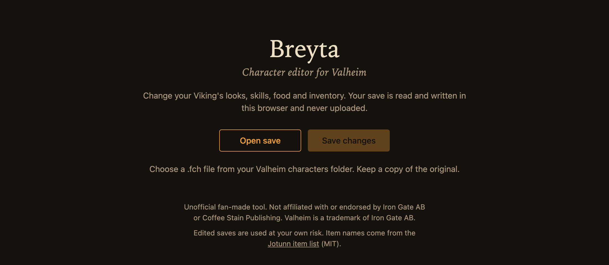

# Breyta

A character editor for Valheim that runs entirely in your browser.

**Open Breyta: [https://breyta.pages.dev](https://breyta.pages.dev)**

_Breyta_ is Old Norse for "to change".



## Features

- **Character**: name, body, beard, hair, skin colour and hair colour
- **Food**: what you have eaten and how many minutes each lasts
- **Inventory**: add, remove and replace items, and set stack, quality and durability
- **Skills**: set any skill from 0 to 100, one at a time or all at once

Your save is read and written in the browser. Nothing is uploaded: once loaded, the page is not allowed to make network requests.

## Usage



1. Close Valheim.
2. Back up your character file.
3. Open Breyta and choose your `.fch` file.
4. Make your changes and select **Save changes**.
5. Replace the original file with the downloaded one.

Characters are stored in:

| Platform | Folder                                                             |
| -------- | ------------------------------------------------------------------ |
| Windows  | `%USERPROFILE%\AppData\LocalLow\IronGate\Valheim\characters_local` |
| Linux    | `~/.config/unity3d/IronGate/Valheim/characters_local`              |

Characters stored in Steam Cloud can overwrite local edits when the game syncs.

## Compatibility

Breyta reads two versions of the save format:

| Profile | Player | Inventory | Skills |
| ------- | ------ | --------- | ------ |
| 46      | 33     | 109       | 2      |
| 47      | 34     | 110       | 2      |

A save in any other version is rejected rather than modified.

## Run locally

The site is static files in `public/`. Serve the folder with any web server:

```sh
python3 -m http.server -d public
```

Then open `http://localhost:8000`.

## Credits

Item, beard and hair names come from the [Jotunn item list](https://valheim-modding.github.io/Jotunn/data/objects/item-list.html), MIT License, © 2021 JotunnLib Team.

## Disclaimer

Breyta is an unofficial fan-made tool. It is not affiliated with or endorsed by Iron Gate AB or Coffee Stain Publishing. Valheim is a trademark of Iron Gate AB. Edited saves are used at your own risk.

## License

[MIT](LICENSE)
